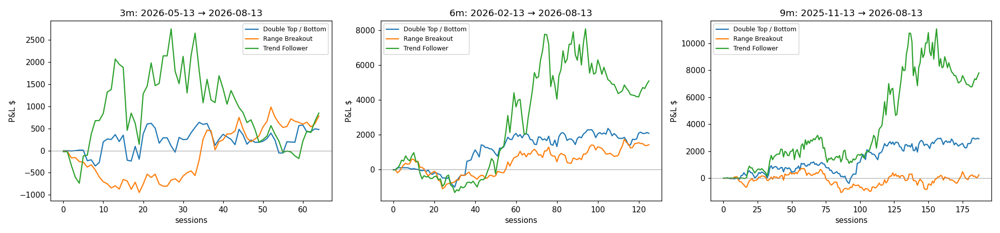

# Strategy comparison — Trend Follower vs Range Breakout vs Double Top/Bottom

Data: the 233 stored sessions (2025‑09‑11 → 2026‑08‑13) of MTUM + QUAL + DYNF holdings,
split‑adjusted close series, **no volume** (volume rules inactive for all three).
Identical money rules for every strategy: $100k book, $1,000 hard cap per issuer, one position
per issuer across ETFs, max 25 positions (`skip` policy), $1 commission, **fills at the next
session's close**, books marked to market at the window's last date.
Produced by `python cli/backtest.py --out analysis/strategy_comparison.md`
(full tables: `strategy_comparison.md`, trades: `strategy_comparison.csv`).

## Headline numbers

| window | metric | Trend Follower | Range Breakout | Double Top/Bottom |
|---|---|--:|--:|--:|
| **3 m** (May 13 → Aug 13, 65 d) | trades / closed | 119 / 47 | 81 / 28 | 178 / 77 |
| | win rate · payoff | 30 % · 1.83 | 14 % · 0.40 | 58 % · 0.84 |
| | expectancy per closed trade | −$14 | −$53 | +$7 |
| | realized / unrealized | −$662 / +$1,535 | −$1,488 / +$2,296 | +$524 / −$22 |
| | **total P&L / peak deployed** | **+$873 / +3.0 %** | +$808 / +2.9 % | +$502 / +2.0 % |
| **6 m** (Feb 13 → Aug 13, 126 d) | trades / closed | 247 / 111 | 137 / 56 | 316 / 146 |
| | win rate · payoff | 31 % · 3.83 | 18 % · 2.13 | 60 % · 0.95 |
| | expectancy per closed trade | **+$33** | −$26 | +$15 |
| | realized / unrealized | +$3,675 / +$1,442 | −$1,431 / +$2,883 | +$2,112 / −$10 |
| | **total P&L / peak deployed** | **+$5,117 / +14.6 %** | +$1,452 / +5.1 % | +$2,102 / +8.3 % |
| | Sharpe (on $100k equity) | 1.18 | 1.08 | 1.35 |
| **9 m** (Nov 13 → Aug 13, 188 d) | trades / closed | 297 / 136 | 205 / 90 | 514 / 245 |
| | win rate · payoff | 45 % · 2.68 | 26 % · 1.20 | 60 % · 0.92 |
| | expectancy per closed trade | **+$46** | −$28 | +$12 |
| | realized / unrealized | +$6,294 / +$1,537 | −$2,553 / +$2,817 | +$2,947 / −$10 |
| | **total P&L / peak deployed** | **+$7,831 / +21.8 %** | +$264 / +0.9 % | +$2,936 / +11.5 % |
| | max drawdown (of $100k) | −3.9 % | −1.8 % | −1.6 % |
| | Sharpe | 1.33 | 0.14 | 1.30 |

Notes: the 9‑month window starts 44 sessions into the data, so the Trend Follower's first
15 sessions and Range Breakout's first 5 are inside their indicator warm‑up (fewer signals
early on). Drawdown/Sharpe are computed on the whole $100k book of which only ~$25–35k is
ever deployed, so they are diluted by ~3–4× for all three equally.

## Reading the results

**Trend Follower** is the best of the three on every window of 6 months or more and is the
only one with a strongly positive expectancy per trade (+$33–46 per $1,000 trade). Its
profile is classic trend following: a low hit rate (30–45 %) compensated by a 2.7–3.8×
payoff ratio (average win $190–265 vs average loss $70). It is the most volatile of the
three (drawdown −3.9 %) because it holds longer (median 18–22 sessions) and lets winners run
with a 8–25 % trailing stop. Over the 3‑month window it is flat: the May–August period had
the market rolling over in June and the strategy was stopped out of its winners before the
next leg.

**Double Top/Bottom** is the steadiest: 58–60 % win rate in every window, the smoothest
equity curve and the lowest drawdown, but the measured‑move target caps the average win at
≈ the average loss (payoff 0.84–0.95), so the edge per trade is small (+$7–15) and it needs
~2× the trades of the trend follower to earn half as much. Its exits are almost entirely
decided by the fixed stop/target; the double‑top exit fired 38 times in 9 months with a
13 % win rate, i.e. it usually confirms a loss rather than protecting a gain. It is a
reasonable *complement* (low correlation with a trend strategy — it buys reversals) but not a
replacement.

**Range Breakout** is the weakest here: 14–26 % win rate, break‑even over 9 months and
losing over 6 months on realized P&L. Two things explain it. Tight 20‑day bases in a
momentum/quality universe mostly resolve into continuation *of the prior move*, and with
no relative‑strength or trend‑slope filter the strategy buys as many bases in decaying names
as in leaders; and the hard stop at the base low (typically 6–10 % away) is hit before the
measured move has time to play out. The original "failed‑breakout" exit (close back under
the breakout level after 5 days) was even worse (−$5.8k from 228 exits at 13 % win) — most
breakouts retest — so it is disabled by default (`fail_days=0`) and the strategy now rides
winners with a trailing stop after the target instead of selling them. That made it
break‑even rather than losing, no better. Adding the trend follower's RS‑rank filter would
probably help, but at that point it *is* the trend follower with a shorter lookback.

**Fill sensitivity** (9 m, same‑day vs next‑day fills): Trend Follower +$7,393 vs +$7,831,
Double Bottom +$3,176 vs +$2,936, Range Breakout −$728 vs +$264 — none of the three depends
on execution timing.

**`--max-positions-policy replace`** (replace the weakest losing position when a new signal
arrives and the book is full): Trend Follower +$8,035 (vs +$7,831), Double Bottom +$3,565
(vs +$2,936), Range Breakout −$1,574 (vs +$264) over 9 months, with 1.6–2.4× the trades. It
helps the two strategies that have an edge a little and hurts the one that doesn't — it just
compounds whatever expectancy the entries have. Default stays `skip`.

**Rising stars priority** (`--rising-priority on`: signals that were skipped because the book was
full get the next free slot before fresh signals, most persistent first) over 9 months:
Trend Follower +$3,731 (vs +$7,831 off), Double Bottom +$3,180 (vs +$2,936), Range Breakout
+$1,111 (vs +$264). A breakout that has been firing for many sessions without being bought is,
for a trend follower, a late entry into an extended move — so the trend follower is better off
with its own rank (freshest, strongest breakout first). The pattern strategies gain slightly,
because a neckline/base break that keeps holding is confirmation. Default is **off**; the
watchlist itself is always kept and reported.

## Recommendation

Run `trend_follow` as the session strategy. Keep `double_bottom` as the candidate second
book once the volume rules can be switched on (its neckline‑break entry is the one most
improved by a volume confirmation in the literature). Revisit `range_breakout` only with a
relative‑strength filter and real high/low bars (its base detection is done on closes here).

All three remain **unvalidated with volume** — store `daily_bars` (see README → Market data)
and re‑run `cli/backtest.py` before relying on the bracketed rules.
